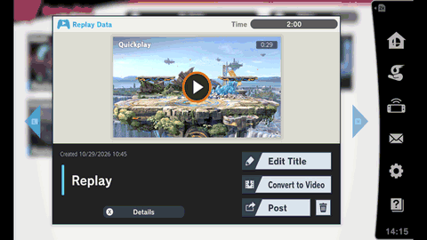

# ssbu-desync-detector

> **Disclaimer:** this project was developed with the assistance of AI
> (Claude, Codex and other coding agents) under the operator's direction and
> review. Nothing is claimed beyond the dated tests cited below.

Skyline plugin for Super Smash Bros. Ultimate 13.0.5 that records what ended
an online match and keeps the evidence a vanilla replay needs to show which
console desynced. Read-only: safe to leave on online.



*An unmodded game plays back the recording of a console that left vanilla and
refuses to go on past the desync (Eden, 2026-10-29).*

## How it works

**1. Play online.** Each frame both consoles compare one check value. On a "No
contest" the log shows the frame and both values, and the match's recording is
saved as `match-N.bin`:

```text
desync frame=1128 ours=0x720d5ecb theirs=0x4aec250b peer=1
sync_end trigger=desync kind=2 frame=1132 local=0 desync_seen=1
recording slot=0 entry=0 bytes=23088 records=1170 source=committed outer=game
```

The values alone can't say who left vanilla: both consoles log the same pair.

**2. Replay it unmodded.** Copy `match-N.bin` to
`save_data/replay/replayYYYYMMDDhhmmss.bin` in a game with only this plugin
(Eden works) and play it from the Vault. If this console left vanilla, the
game stops where it can no longer reproduce it (above).

**3. Ask the referee.** With both detector folders:

```text
cargo run --example referee -- <console-dir> 0 <vanilla-dir> 1
desync:   frame 1128, from station 1
          this console  0x720d5ecb
          other console 0x4aec250b
vanilla:  at the desync frame 0x4aec250b = the other console's value
verdict:  this console left vanilla
```

Whichever value the vanilla game reproduces belongs to the console that
stayed vanilla.

## Install

Copy `libssbu_desync_detector.nro` to
`sd:/atmosphere/contents/01006A800016E000/romfs/skyline/plugins/`. Output goes
to `sd:/ultimate/ssbu-desync-detector/`. Recordings are kept only for matches
that did not end normally, and the log is capped, so it stays small.

## More

- [docs/EDEN-PROOF.md](docs/EDEN-PROOF.md): the forced-desync test in Eden.
  It has not run through a real desync on a Switch yet.
- [docs/WHAT-IS-CHECKED.md](docs/WHAT-IS-CHECKED.md): what the online check
  compares, and how to test a plugin for desyncs (`cargo run --example compare`).
- [docs/HOOKS.md](docs/HOOKS.md): hook sites, files and verdicts.

## Build

```text
cargo test
cargo skyline build --release
```

## License

MIT
