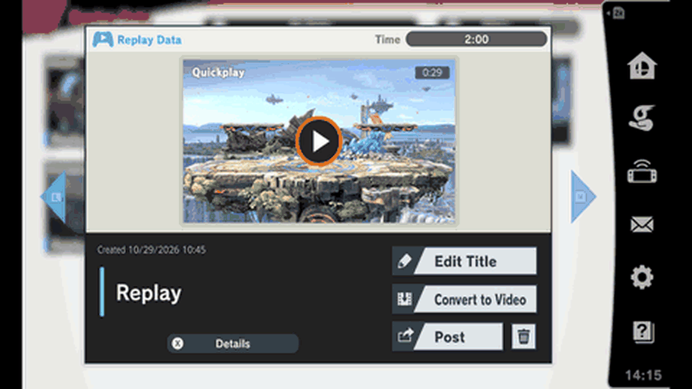
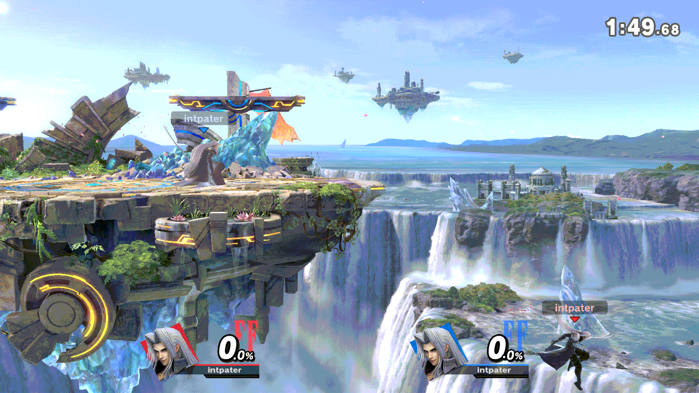

# ssbu-desync-detector

> **Disclaimer:** this project was developed with the assistance of AI
> (Claude, Codex and other coding agents) under the operator's direction and
> review. Nothing is claimed beyond the dated tests cited below.

Skyline plugin for Super Smash Bros. Ultimate 13.0.5 that records what ended
an online match and keeps the evidence a vanilla replay needs to show which
console desynced. It observes match state without changing the simulation.



*An unmodded game plays back the recording of a console that left vanilla and
refuses to go on past the desync (Eden, 2026-10-29).*

## How it works

**1. Play online.** Each frame both consoles compare one check value. On a "No
contest" the log shows the frame and both values, and the match's recording is
saved as `match-N.bin`:

```text
desync frame=1128 ours=0x720d5ecb theirs=0x4aec250b peer=1
sync_end trigger=desync kind=2 frame=1132 local=0 desync_seen=1
recording slot=0 entry=0 bytes=23088 records=1170 source=committed outer=game
```

The values alone can't say who left vanilla: both consoles log the same pair.

**2. Replay it unmodded.** Copy `match-N.bin` to
`save_data/replay/replayYYYYMMDDhhmmss.bin` in a game with only this plugin
(Eden works) and play it from the Vault. If this console left vanilla, the
game stops where it can no longer reproduce it (above).

**3. Ask the referee.** With both detector folders:

```text
cargo run --example referee -- <console-dir> 0 <vanilla-dir> 1
desync:   frame 1128, from station 1
          this console  0x720d5ecb
          other console 0x4aec250b
vanilla:  at the desync frame 0x4aec250b = the other console's value
verdict:  this console left vanilla
```

Whichever value the vanilla game reproduces belongs to the console that
stayed vanilla.

## Install

Copy `libssbu_desync_detector.nro` to
`sd:/atmosphere/contents/01006A800016E000/romfs/skyline/plugins/`. Output goes
to `sd:/ultimate/ssbu-desync-detector/`. Recordings are kept only for matches
that did not end normally, and the log is capped, so it stays small.

0.5.0 (unreleased) adds read-only match telemetry to `events.log`: the rules and fault-table limits at an online
match's start, each KO the fault table counts, which peer-end path ended the session, the phase-6 end with its
network result, and one `session_summary` line per session. With `ssbu-stall-press-carry` 0.2.0 loaded, the summary
also shows how many presses and stick flicks that plugin carried. The last online session's verdict is also kept in
`last-session.txt`. The dialogs are unchanged from 0.4.0. Host tests cover every line. Not yet seen in a match. See
[docs/MATCH-TELEMETRY.md](docs/MATCH-TELEMETRY.md).

[0.4.0](https://git.syntaxbyexample.com/intpa/ssbu-desync-detector/releases/tag/v0.4.0)
(2026-11-07) writes one `events.log` line when Smash arms the countdown that
stops the frame counter: the fault-table number (`code`), the frame, the
mask, and the ten table words. It also appends the same evidence-based
reason to the English labels "Canceled", "Canceled.", and the reconnect
warning "You disconnected in the middle of your last online battle.", and
logs which function asked for that text. A notice with no session verdict
is left unchanged. Host tests cover the line and those labels. Not yet
seen on a Switch or in Eden.

[0.3.0](https://git.syntaxbyexample.com/intpa/ssbu-desync-detector/releases/tag/v0.3.0)
(2026-11-06) adds the disconnect reason and telemetry below. In Eden the
game's "A connection error has occurred." pop-up then shows the reason.
Not yet seen on a Switch.

| | Without the reason | With 0.3.0 |
|---|---|---|
| **Desync** |  |  |

*Eden, 2026-11-06. The same Quickplay route, TrainingRooms 0.2.0-rc.2
(`23b89786`) on station 1 only, so the first death desyncs. Without: released
0.2.0 (`29067bb6`, commit `550cae6`), run `dd-gif-b1`, desync frame 908, the game's own
"A connection error has occurred." With: released 0.3.0 (`0ac90bc6`, commit
`49214c1`), run `dd-gif-a1`, desync frame 732, the same pop-up plus
"Reason: Desync detected. The consoles stopped agreeing on the match."
Peer ended, timeout, local link, local status and unknown were not reproduced:
Home, then stopping the other instance, showed "You have been disconnected due
to inactivity." and neither build logged `peer_end`, `sync_end` or
`communication_text` (`dd-gif-a2`, `dd-gif-a3`, `dd-gif-b2`, `dd-gif-b3`).*

[0.2.0](https://git.syntaxbyexample.com/intpa/ssbu-desync-detector/releases/tag/v0.2.0)
(2026-10-31) is 0.1.0's code built with link-time optimization: 124 KiB of
memory instead of 552 KiB.

## More

0.3.0 appends an evidence-based reason to English communication-error
messages, keeping their original text and codes. It covers both ways the game
builds that text: sentences with placeholders, and plain sentences such as
"A connection error has occurred." It distinguishes recorded desyncs, local
network status, an abnormal peer end, timeout and unknown. It does not infer a
deliberate quit from silence or identify faulty hardware. Other languages and
system error applets are not covered. See
[the dated work report](docs/DISCONNECT-DIALOG.md), which also traces the
2026-11-05 desync to TrainingRooms' waiting-room flag.

0.3.0 also records five-second telemetry and snapshots around network changes
and disconnect events: the console clock, polling intervals, frame activity
and capture-loss counters. Keep both `events.log` and `events.previous.log`
after a recurrence; the summary tool reads them together. This helps
correlate an incident with router records, but does not by itself identify a
faulty network component.

- [docs/EDEN-PROOF.md](docs/EDEN-PROOF.md): the forced-desync test in Eden.
  It has not run through a real desync on a Switch yet.
- [docs/WHAT-IS-CHECKED.md](docs/WHAT-IS-CHECKED.md): what the online check
  compares, and how to test a plugin for desyncs (`cargo run --example compare`).
- [docs/HOOKS.md](docs/HOOKS.md): hook sites, files and verdicts.

## Build

```text
cargo test
cargo skyline build --release
```

## License

MIT
