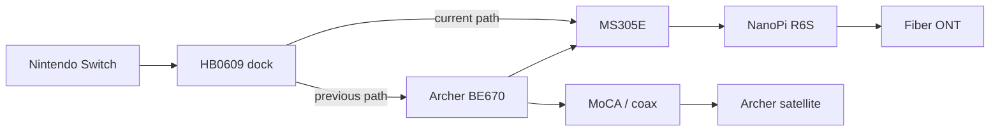

# Disconnect reasons and incident evidence

## 2026-11-05: the pop-up's no-argument route

On the Switch, telemetry build `02488cdc` logged a real desync at 15:32:57
(`desync frame=4348 ours=0x7774d5d0 theirs=0x9985577d`, `sync_end
trigger=desync`) and the game showed its "A connection error occurred"
pop-up, with no `communication_text` event: the reason was not added.

The game sets label text two ways. The pop-up manager's body text function
`.1eef640` (called from the pop-up dispatch at `.32f1cc4`) calls `.37a2660`
when the message has arguments and `.377a120` when it has none. Only the
first passes the formatter `.37ab750` that the hook at `.37ad8e8` watched.
`.377a120` formats through `.37ae170` into its own zeroed 0x1000-byte stack
buffer and hands the count to the pane setter `.37a2270`. A sentence with no
placeholders therefore never reached the hook (static, hash-verified 13.0.5
NSO; dynamic confirmation below).

Branch `feat/disconnect-popup-route` adds a second route, `plain`, hooked at
`.377a250` between `.37ae170`'s return and the setter call; both routes share
one hook body (`append_in_frame`) and the same reason, filter and append
rules. Install line: `dialog=installed text_routes=args,plain`; event:
`communication_text … route=plain`. Sites, guards and the card scan:
[HOOKS.md](HOOKS.md). Release build `92fbcf84` (57,344 bytes, 136 KiB
resident); host tests, clippy, no-default-features, release and diag builds
pass.

Eden, Yoga, same-host LAN Online pair, Eden `fefd2b5f`, detector and tile
cursor only (runs in `/home/intpa/eden-runs/`):

- `dd-popup-y01` (build `680bc561`): Quickplay matches; the pop-ups that
  appeared ("You have been disconnected due to inactivity.", "When playing
  online, please refrain from unsporting behavior…") went through the pop-up
  body `.1eef640` (labels `pop_online_penalty_leaving`,
  `pop_online_penalty_disturbance_warning`, argument vector empty) and the
  `plain` site `.377a250` with FP = SP+0x1150. A peer whose emulation was
  paused and resumed showed the system's own error applet (2306-0332), which
  no plugin text hook reaches.
- `dd-popup-y03`: a ran release `b5fa80f8`, b the diag build `012e8146` with
  `force_desync_frame=600` (an Eden-only switch that stores b's frame-600
  check value with its low bit flipped; simulation untouched). Both logged
  `desync frame=600`, `sync_end trigger=desync … caller=0x16d6b08` (the
  Switch's caller) and `communication_text reason=desync text_units=102
  route=plain`, and both showed the orange-and-white pop-up "A connection
  error has occurred." followed by "Reason: Desync detected. The consoles
  stopped agreeing on the match." On a, trace points recorded the label
  `pop_sync_error` with no arguments at `.1eef640`, the 32-unit text at
  `.377a250` (called from `.1eef838`, dispatch `.32f1cc8`), and the setter
  `.37a2270` receiving the same buffer (SP+0x120) with 102 units and the
  reason. The argument route's point did not fire. Consoles: no panic,
  abort, crash or Unmapped line; a's unmapped-access total 0. Screenshot:
  row `r05-desync-popup`, `a-233408Z-613373-popup.png` (and b's
  `b-233408Z-168310-popup.png`); a's second shot 3 s later
  (`a-233411Z-…-popup-settled.png`) is all black and is not evidence.

- `dd-popup-y05`: a ran release `92fbcf84` (the final source; it differs
  from `b5fa80f8` only in its build ID and four panic line numbers), b the
  diag build `45a6b424`, which now forces the desync once per boot. Match 1
  repeated `dd-popup-y03` (pop-up with the reason, `route=plain`, on both).
  Match 3 ran unforced to its 2:00 time limit with varied input on both
  (down + shield alone was dropped for inactivity in match 2) and ended
  normally on both at the same frame: `sync_end trigger=normal kind=1
  frame=7521 … desync_seen=0`, `peer_end reason=1`, `not_kept
  reason=normal_end`, no `communication_text`. Consoles clean, a's
  unmapped-access total 0.

The argument route (`.37ad8e8`) installed in every boot and passes the host
tests; no pop-up with arguments and a communication-error sentence appeared,
so it did not run in Eden.

## 2026-11-05: the 15:32:57 desync, replayed

The card's `match-0.bin` (Quickplay (Elite), Mr. Game & Watch and Fox on
Yoshi's Island (Melee) in its Battlefield form, 3 stock 7:00, 1:28; read off
the replay's own details screen, `a-021029Z-141864-replay-details.png` of run
`dd-popup-mods1`) was played from the Vault in Eden (run `dd-popup-y01`, Eden
`fefd2b5f`, Yoga) with only this detector (`680bc561`) and the tile cursor:
no other plugin and no ARCropolis, so no mod could load. A trace point on the playback
check recorded the nine RNG streams every frame. Evidence: rows
`r15-vault` to `r18-playback` and `r19-recopy` (the playback's detector
folder copied after its frames file closed) of that run; the outputs below
are `taskb-referee-closed.log`, `taskb-stream-attribution.log`,
`taskb-referee-cardset.log`, `taskb-stream-attribution-cardset.log` and,
for the mods run (playback slot 2), `taskb-referee-mods-{a,b}.log` and
`taskb-stream-attribution-mods-{a,b}.log` in the popup-route work folder,
whose `evidence/` has every file with its sha256.

```text
cargo run --example referee -- <card detector folder> 0 <playback detector folder> 1
python3 -I -B tools/stream_attribution.py <trace.jsonl> --frame 4348 --ours 0x7774d5d0 --theirs 0x9985577d \
    --playback-frames <playback frames-1.bin> --console-frames <card frames-0.bin> --reconstruct
```

- The unmodded playback reproduced this console's online check value on
  every frame 0–4151 (4,152 of 4,152). At frame 4151 the game could not
  reproduce this console's recorded positions (`playback_mismatch
  frame=4151 computed=0xa417d4d4 recorded=0x613d0d23`) and stopped. Referee
  verdict: this console left vanilla. The traced streams' XOR equals the
  detector's playback value on all 4,152 frames.
- From 4151 to the desync, this console's logged values are explained
  uniquely by two `sound` draws (frames 4311 and 4314) and reproduce its
  4348 value `0x7774d5d0`. The other console's `0x9985577d` is this state
  with one more `sound` draw: the first checked difference between the two
  consoles is one extra `sound` draw on the other console at frame 4348.

- With the card's own plugin set instead (run `dd-popup-ab1`: the 18 NROs
  of the 2026-11-05 06:45 copy, the card's detector `02488cdc` and its
  ARCropolis among them, and the card's Deluxe `config.ini`), the playback
  stopped at the same frame with the same values (`playback_mismatch
  frame=4151 computed=0xa417d4d4 recorded=0x613d0d23`), the referee gave the
  same verdict, and the stream reconstruction gave the same result.
  Correction: that profile was not mod-free. The Yoga's base profile already
  carried three of the card's seven mods, byte-identical to the card's files
  (Cosmic Destination, Less Distracting Northern Cave, Less Distracting Umbra
  Clock Tower), and ARCropolis was loaded.
- With the card's ARCropolis (`92171b2f`) and all seven of the card's mods
  (run `dd-popup-mods1`, Surface, 2026-11-06; the 586 files of the primary's
  read-only copy, checked against its sha256 manifest, in `ultimate/mods`):
  instance a with only the card's detector `02488cdc` and ARCropolis,
  instance b with all 18 card NROs and the card's Deluxe `config.ini`. The
  mods loaded in both: on the game's own Training stage select, the Final
  Destination tile is the Cosmic Destination tile (mean absolute difference
  21 to the mod's `stage_1_end.bntx`, 73 to stock;
  `a-015556Z-738281-sss-mod-proof.png`, `b-015618Z-795013-sss-mod-proof.png`),
  and ARCropolis's `discovery.cache` names all seven mods on both. Both
  playbacks stopped at frame 4151 with the same values (`playback_mismatch
  frame=4151 computed=0xa417d4d4 recorded=0x613d0d23`). The referee gave the
  same verdict and the stream reconstruction the same result (two `sound`
  draws at 4311 and 4314 give `0x7774d5d0` at 4348; the other console's value
  is one more `sound` draw). The playback frames file is byte-identical in
  `dd-popup-y01`, `dd-popup-ab1` and both instances here (sha256 `33c2ab12…`,
  4,152 frames). No mod touches this match's stage, Fox or Mr. Game & Watch:
  Final Destination, Hollow Bastion, Northern Cave and Umbra Clock Tower
  stages, a Kirby model, the GAME SET narration and info layouts. There
  was nothing to bisect because no plugin or mod changed the result.

Established: the operator's Switch ("this console"; station 1 in that
match, its frames file's flags are `0x101`; `peer=0` in the desync line is
the other console) left vanilla. With the same inputs, its simulated positions first differed
from an unmodded game's at frame 4151: the recording holds the game's
position checksum for every frame, and the referee's first frame it could
not reproduce is 4151. The checked RNG still agreed through 4151. The first
checked value to differ between the consoles was
at frame 4348 (`0x7774d5d0` here, `0x9985577d` on the other console), one
extra `sound` draw on the other console (the stream behind launch voices
and `PLAY_SEQUENCE` variants, [WHAT-IS-CHECKED](WHAT-IS-CHECKED.md)). The
card's 18 plugins, as they run during a replay playback with the card's
Deluxe settings, do not reproduce this console's positions either. Neither do
the card's seven mods loaded by the card's ARCropolis, alone or with the 18
plugins: those playbacks are frame-for-frame identical to the unmodded one.
The match was on Yoshi's Island (Melee), Battlefield form.

Not established at that point: what changed this console's positions, and
whether the other console was vanilla (only this console's recording exists).
Open then: plugin behaviour that runs only online (a playback cannot show it)
and the console itself. The next section answers the first.

## 2026-11-06: what changed this console's positions

Evidence is in the popup-route work folder: `taskb2/` (scripts and logs) and
`evidence/` (`dd-popup-pos1`, `dd-popup-pos2`, `dd-popup-ty1`,
`dd-popup-pos5`, `taskb2/`; each with its sha256 in `evidence/manifest.json`).
The diag switch is on branch `taskb/playback-continue` (`8def90b`).

**What differed.** The game's replay check (`.135fc84`–`.135fd5c`) is the
32-bit sum of the x, y and z bit patterns of eight fighter-slot position
vectors (`sp+0x70`). A trace of them during the vanilla playback (run
`dd-popup-pos1`) matches the computed sum on all 4,152 frames. Fox was
KO'd at the right blast zone at frame 4148 and stays frozen at
(240.6212, 74.0794). The console's recorded sum at 4151 is exactly the
vanilla sum with Fox at **(0.0, 170.0, 0.0)**, the rebirth point. Run
`dd-popup-pos2` (detector diag `6bc2489a`, `playback_continue=1`: the
playback keeps going past the mismatch) shows vanilla moving Fox there at
**frame 4210**, 62 frames after the KO, then lowering him on the rebirth
platform. On the console Fox was there at 4151, 3 frames after the KO, and
did not then follow vanilla's descent (`positions.py`, `shift_test.py`).
So this console ran Fox's death with a ~1-frame dead wait and no rebirth
platform wait. Fox was this console's own fighter.

**Why.** TrainingRooms 0.2.0-rc.2 is on the card (`libtraining_rooms.nro`
`23b89786`, installed 2026-11-05 03:46Z). That NRO equals the Forgejo
release `TrainingRoomsForUltimate` v0.2.0-rc.2, commit `36d7f46`. In it:

- Every Training behaviour asks `scene::is_training()`, which is native
  Training **or** `LOBBY_ACTIVE`, the waiting-room practice flag
  (`src/runtime/scene.rs:34-36`, `src/model/scene.rs:20-23`).
- `LOBBY_ACTIVE` is set and cleared only in `lobby::update()`, when it sees
  the scene change (`src/runtime/lobby/training/lobby.rs:75-121`).
  `update()` is called from one place: the input-mapping hook, and only when
  the mapped slot is 0 (`src/runtime/features/input_delay.rs:50-53`).
- With the save-state feature on, a death reads
  `dead_rebirth_wait_frame` as 1 and `rebirth_move_frame`,
  `rebirth_wait_frame`, `rebirth_invincible_frame` and
  `rebirth_invincible_add_frame` as 0 (`src/runtime/features/states.rs:1147-1171`,
  `src/model/state/hooks.rs:20-45`). Other Training-only answers come with
  it, for example "can star KO" is false (`states.rs:1305-1310`).
- The card's TrainingRooms settings (13:14Z capture, before the match) have
  Lobby practice On, Save states On, Respawn invincibility Off. That is
  exactly the instant-respawn case.

In an online battle where this console is station 1, its local controller is
mapped for slot 1, so `update()` never runs. The CPU pilot's own Eden run
`o14` saw the same thing: inside the same input-mapping function, the station-1
console's one mapped slot was 1 (`ssbu-cpu-pilot/docs/EDEN-RESULTS.md:155-164`). The practice flag set in the
waiting room stays true into the battle, and every death of a fighter on this
console takes the Training values. The other console takes the game's values.
Positions then differ, which the online check (RNG only) does not compare.
The check differed 197 frames later through a `sound` draw. This also explains
why only this match desynced:

- The card's other seven recorded online sessions all had this console at
  station 0 (frames flags `0x1`) and ended normally.
- TrainingRooms' own log of a morning Quickplay as station 0 shows the flag
  cleared at the battle start (`#561 scene … melee=0x0e`,
  `#562 [LobbyPractice] active=false`).
- Deluxe's log shows the waiting-room practice stage loaded 19 s before this
  match.

**Excluded:**

- The card's mods: the match was not on a modded stage, and the playbacks
  with them are byte-identical.
- The CPU pilot: the release build always starts with P1 as the player
  (`src/runtime.rs:735-741`). Its page was never opened in that boot (Deluxe
  log: one overlay chord, Hidden → Settings), and with P1 as the player its
  online hooks take no lease (`core/src/online.rs:85`).
- Deluxe: it writes no simulation state; its online-only behaviour is timing
  and the Horizon-OC gate (`taskb2/deluxe-audit.md`).
- memory-guard: no repair logged that boot.

A hardware fault would not produce this clean, rule-shaped change at the first
KO of the match.

**Eden proof** (Yoga, Eden `fefd2b5f`, 2026-11-06, both claims released clean).

Run `dd-popup-ty1` was a same-host LAN Quickplay pair:
- a: detector `92fbcf84` and tile cursor only.
- b: the card's TrainingRooms `23b89786` with `libnro_hook`/`libparam_hook`, the card's TrainingRooms settings, the detector and tile cursor.
- a readied first and became station 0; b readied second and became station 1 (frames flags `0x1` / `0x101`).

What happened:
- b's TrainingRooms logged the waiting-room practice on (`[LobbyPractice] scene … melee=0x0d mode=0x07010101`, `active=true`).
- After the battle (melee 0x0e) began, it logged no scene change and no `active=false`.
- b's fighter ran off the stage. Both detectors logged `desync frame=837` (a: `ours=0xaf8e5338 theirs=0xd764b014 peer=1`; b the reverse, `peer=0`), and the pop-up showed the reason on both.

Run `dd-popup-pos5` played both kept recordings in vanilla (diag `playback_continue=1` and the position trace):
- The vanilla console's recording plays to its end (frame 887) with no mismatch.
- The TrainingRooms console's recording first fails at frame 536. b's fighter was KO'd at 533 and frozen at (168.0097, −154.5136). Vanilla moves it to (0, 170) at 595 (KO+62) and lowers it 166.586, 163.243, …. The recording has it at (0, 170) at 536 (KO+3) and then not on that descent (`taskb2/shift-test-ty1-tr.log`).

That is the card's signature exactly, 59 frames early. The plugin set was only TrainingRooms and its two dependencies.

Not fixed here (the order was to find causes). The change belongs in
TrainingRooms, another project. Its waiting-room flag must not outlive the
waiting room for a console that is not station 0. Either the scene check must
run on every frame for whichever slot this console maps (not only slot 0), or
the widened predicate must re-check the live scene (melee 0x0d) each time it
is asked. Until then, a TrainingRooms console with Lobby practice on can
desync its online battles whenever it plays as station 1 and a fighter of its
own dies.

## 2026-11-03

Local candidate on `feat/disconnect-reason-dialog`.
The pre-telemetry UI candidate booted in Eden and its hook installed;
the target communication-error dialog remains unverified. The newer
telemetry candidate has host/build checks only. It was installed as a local
development candidate on2026-11-03; it is not a published release and its
next console run is pending.

## Next-run telemetry candidate

The next-run source adds bounded snapshots every five seconds and after
network changes, session-end/mismatch/peer-end events and reason-text
preparation. Existing hooks are unchanged. The existing writer thread
reads NIFM and the console's system clock; it adds no network traffic or
simulation writes. Events still have their own original ticks. A snapshot
after an error records its observation time, not an inferred cause time.

Each `telemetry` row retains raw network result/interface/strength/state,
actual poll interval and count, session/slot/frame activity, console Posix
seconds with SDK status/query duration, and cumulative event/frame-ring
overwrite, evidence-contention and Rust heap-allocation counts. Zero
counters describe these measured losses; they cannot prove complete
capture of every possible native error route. A `frame_gap` means that no
frames were observed for five seconds; it supplies no native end or reason.
`active=0` means the writer is outside its frame episode; kind/slot/frame
can still identify the preceding episode. `frame_age_ms=18446744073709551615`
means no frame tick has been observed. Polling remains nominally500ms;
urgent events request another sample on the existing100ms writer loop.

Telemetry uses fixed stack buffers, no per-frame formatting, and the
existing1MiB log rotation with one previous file. The formatter's maximum
integer test verifies its768-byte buffer retains the complete row and
newline. Clock samples are usable only with initialized clock/result0.
The parser reports UTC windows including second truncation and SDK query
duration and exposes discontinuities. These are console-clock estimates,
not independently measured synchronization with the router.

After a recurrence, retain the whole detector folder, especially both
logs and the matching frame/match files, then run:

```text
python3 -I -B tools/summarize_disconnect.py <events.log> --previous <events.previous.log>
```

Omit `--previous` if that file is absent. `boot_tick` scopes a rotated log
even when its install marker is gone; the output says where coverage
begins. Existing TM-log correlation remains a labelled fallback when no
usable direct clock sample exists. Never treat a post-error undock as the
cause of an earlier message. Current incident-time hardware attribution
remains unresolved. Build/check receipts and the final candidate identity
are retained in the work folder's telemetry manifest and reports.

The built telemetry candidate is SHA256
`02488cdc8e0e4ab2a3da0cd83cc2b2e363ef00c6e714227599675b7da43e82ee`.
Release and diag NROs are byte-identical:53,248bytes,135,168bytes resident
(132KiB). The candidate was installed overDBI at16:13:34Z on2026-11-03.
The original detector29067bb6 has a verified on-card/local rollback copy;
all17plugin and3protected-file readbacks passed, with the other16plugins
and all protected settings unchanged. Receipts and independent verification:
`/home/intpa/ssbu-cpu-pilot-work/switch/install-telemetry-20261103-1611/`.
The operator controls DBI/card connections; no agent mount or connection
operation was used.37files/2707535B of pre-update logs/crash evidence were
saved under`work/switch/card-20261103-1611` before replacement. Three new Rust
cases cover raw telemetry/loss retention, maximum complete line length
and gap semantics; twelve parser tests cover scope, rotation, clocks and
capture data. Final build/check logs use the `telemetry-` prefix. No new
Eden test was launched for telemetry; the next physical run is pending.

The requested behavior is to explain the evidence behind a real disconnect
in its existing dialog. Recorded mismatch, a local network-status fault,
an explicit abnormal peer-end message, a timeout and an unknown cause have
different meanings. Silence alone cannot establish that the other player
quit. Network status cannot identify a faulty dock, cable, access point or
router.

The classifier uses fixed storage and static messages. Existing hooks feed
facts before the writer drains logs. Online session identity and frame
restart delimit the evidence; playback and normal endings suppress it.
A nonblocking guard protects the UI snapshot. A missed mutation makes the
episode unusable. A later undock or network change cannot explain a dialog
already shown. No synthetic dialog is opened on a frame gap. The operator
broadened the scope to communication-error messages generally: with no
usable online evidence, append Unknown instead of borrowing an old cause.
The link and verdict windows are each 30 seconds, the peer-end grace is
one second, and admitted event skew is 250 ms. These are conservative
implementation defaults, not timing limits measured on the console.

The new candidate appends to the caller's formatted UTF-16 stack buffer
at the formatter return `37ad8e8`, before its native UI setter. It preserves every original
code unit and support code, appends a complete reason only when it fits,
and changes the native length accordingly. It retains no pointers and
shares no temporary text between calls. All six ABI/instruction guards
must match before the one hook is installed. Its aligned far patch
relocates MOV/ADD/LDP/LDP; the near patch relocates just MOV. Neither
contains a branch or call. Saved LR selects the specific caller, its
guarded frame identifies the buffer, and w20 supplies the native count.
`docs/HOOKS.md` records the sites and dated card scan.

The first candidate at `37a272c` was rejected after static inspection of
Skyline's patch writer: that unaligned site requires five instructions for
a far jump and would relocate the following native call. Its earlier
four-instruction claim was incorrect. No rejected build was installed.

The current filter recognizes the English communication/connection-error
sentences, tolerating line breaks and native text tags. Other translations,
other text-setting routes and system error applets have not been shown to
pass this site. They are not claimed as covered. Real error coverage and
text layout remain runtime acceptance gates. A `communication_text` event
records preparation of an augmented message, not its rendered appearance.

## Retained incident

Raw inputs are in
`/home/intpa/ssbu-cpu-pilot-work/switch/card-20261103-1220`.
The card detector was 0.2.0, SHA256
`29067bb63fd2721ed577f613088614a365804c9ac7101c4ad4ff8b8df3cd23a8`.

Reproduce the bounded log summary from the repository root:

```text
python3 -I -B -m unittest discover -s tools -p test_summarize_disconnect.py
python3 -I -B tools/summarize_disconnect.py <events.log> --tm <practice-diagnostics.log> --frames <frames-0.bin>
```

The original five Python cases remain in the twelve-case suite. The incident output is retained as
`/home/intpa/ssbu-cpu-pilot-work/disconnect-dialog/incident-summary.json`.
It finds 17 sessions after the latest install marker, no recorded mismatch,
and no `sync_end` or `peer_end` for the last session. Its frame file has
3,374 contiguous records, numbered 0–3373. Connection-status observations
alternate between Wi-Fi and Ethernet, with nonzero NIFM results in between.
This establishes observed network-state changes, with incomplete end
telemetry; it does not establish the cause or exclude a missed desync path.

[libnx's NIFM header](https://github.com/switchbrew/libnx/blob/master/nx/include/switch/services/nifm.h)
defines type 1 as Wi-Fi, type 2 as Ethernet and status 4 as connected.
States 0–3 are named unknown. The recorded `0xd46e` decodes numerically as
module 110, description 106. The header's note literally names `0xd46ed`;
interpreting that spelling as a typo is an inference, so this report does
not assign an authoritative physical meaning to the recorded error.

The router's retained logs show no corresponding reboot or WAN/LAN
interface teardown. That does not exclude a brief forwarding fault,
access-point problem, switch-port fault, MoCA/mesh issue or upstream loss.
The independent audit proposed a clock offset and MAC pairing that align
several DHCP exchanges with the Switch transitions. Initially both were
fitted to the same observations. The operator has now independently read
the Switch's wired MAC as `00:E0:4C:69:2D:AD`, confirming that the router's
configured `bazzite` entry is this dock connection. Its repeated DHCP
discovery/request exchanges therefore belong to the Switch's wired path,
rather than an unrelated Bazzite client. The clock offset is still fitted,
not independently measured; those exchanges could be the same incident
or an earlier connection event. They do not identify a faulty component.

The original path was HB0609 Ethernet -> Archer BE670 -> MS305E -> R6S;
the Archer satellite uses Ethernet over MoCA. The console stayed docked
until after the error. Around the incident this dock was used only with
the Switch, not the Bazzite device. The subsequently checked wired MAC
establishes its identity; the saved router label did not do so by itself.
It has since been moved directly to MS305E. This
comparison keeps the dock and router but bypasses Archer forwarding for
the console; a shared LAN loop could still affect both paths. Useful next
evidence is the correct port's retained link/error history and an
independently checked Switch/router clock offset.

The operator identified MS305E management at `192.168.0.134` and the dock
on port 2. A read-only capture at 13:31:47Z, after the cable move, reports
port 2 at 1 Gbps, the R6S uplink at 2.5 Gbps and the AP uplink at 2.5 Gbps.
All five ports report zero CRC packets. Loop prevention is enabled and
power saving is disabled. These are current/cumulative observations;
their reset time and the former port-2 device are unknown, and they do not
establish incident-time link continuity or exclude congestion, packet
drops, USB/power interruption or an Archer forwarding fault. No settings
were changed; the diagnostic login was closed. Whitelisted receipt:
`/home/intpa/ssbu-cpu-pilot-work/disconnect-dialog/netgear-readonly.json`.
The system-status endpoint returned HTTP 500 while port reads succeeded;
that endpoint failure is not evidence of the game's earlier disconnect.

For a recurrence, keep the current direct-MS305E path and capture router
events, port-2 carrier/speed/error counters and Switch telemetry against
one checked clock, filtering the confirmed wired MAC. Sample current port state
during play: this switch exposes no established historical carrier log,
and before/after counters alone can miss a brief link loss. Do not clear
counters or change several settings/components together. A stable Ethernet
carrier would still not exclude a dock's USB-side interruption. If the
direct path remains stable, that is a useful comparison with the Archer
path, not proof that the Archer or MoCA caused the earlier incident.

Static review rejected the first native UI candidate: `0x16bb5b0` is a
shared `ErrorResultVariant` display helper. Filtering its `ShowError`
return addresses would relabel unrelated errors. No hook was installed.
The callback registered at `0x22cafc4` and the `NetworkErrorMessage`
catalog were also shared paths, not a proven text seam. Raw review:
`/home/intpa/ssbu-cpu-pilot-work/disconnect-dialog/native-review.md`.



## Validation still required

The final host suite, all-target Clippy with warnings denied,
no-default-features build, Switch release and diag builds pass without
warnings. Raw logs are `v2-{test,clippy,no-default,release,diag}.log`
in the work folder. The host counting-allocator test covers classifier and
reason append; the final ARM64 callback has no allocation calls in its
inspected path (`ui-callback-v2-disasm.log`). This is not runtime
allocation evidence for the installed card set.

Historical pre-telemetry release candidate SHA256:
`7d5d489f2b6e993700681def8aa23eefdfa1925cde60cc3198e301788439f3bc`.
Its file size is 53,248 bytes, with 135,168 bytes resident (132 KiB),
reported from the NRO header in `v2-size.log` using playbook
`tools/build/nro_size.py`. The declared
diag feature currently adds no code, so its NRO is byte-identical; both
builds and symbol-bearing ELF files are retained separately under
`/home/intpa/ssbu-cpu-pilot-work/disconnect-dialog/artifacts/ui-candidate`.

Independent Grok4.7xhigh review (`ui-v2-review.md` in the work folder)
found no static blocker for this formatter caller. Its scope excluded
acceptance of the final built NRO; the primary verified that retained
artifact against its source receipt and inspected its ARM64 callback.
The historical UI review wrappers and worker watchers are stopped. Full primary
checklist, including failures and unperformed checks:
[COMPLIANCE-DISCONNECT.md](COMPLIANCE-DISCONNECT.md).

## Eden observational run

The operator reauthorized Eden validation. Playbook
`03e23218af1eaa007793bbc21718bd594f4999c7` was pulled and read. The
unchanged candidate above ran on the Ally as `live-pilot2-dialog-e07`,
15:08:54–15:21:39Z. No plugin rebuild, guest-state injection, networking
configuration change, hosting or card installation was used.

The Windows Job enforced 8 GiB and 5,400 seconds, and volume was verified
as zero before loading 13.0.5. The current loader log identifies main
build `21450C647B8C5940ED5B68218EA128FD3C5D597D` at `0x80ebf000`.
The install line reports `dialog=installed heap_allocations=0`. That is
install-time evidence only.

A one-shot guest tracepoint at the observed main base plus `0x37a272c`
(`0x8466172c`) requested x0/x19/x20/sp/pc/pstate and 4,096 bytes from
sp. Ordinary menu navigation entered Online. It displayed “Connecting to
the Internet,” followed by system applet error `2306-0520`, “Unable to
connect to the Internet.” Closing it returned to the main menu. The
tracepoint stayed armed through those actions and was cancelled without
a hit. No `communication_text` event was emitted. This route did not
exercise the selected caller; it neither proves nor disproves the
candidate's behavior for the game's disconnect message. The emulator's
Internet error does not explain the physical Switch incident.

The retained current game log contains zero Unmapped, panic, abort or
crash matches. It also contains 2,482 file-permission-denied messages;
their cause was not established, so this is not a clean full-runtime
acceptance result. The game stopped before the frontend's stale-modal
cleanup required terminating its owned Job (exit 137). Peak Job memory
was 7,257,878,528 bytes. The original 603-file profile was restored and
independently hash-verified; the finished clone was removed.

Raw evidence and reproducible verification:
`/home/intpa/ssbu-cpu-pilot-work/disconnect-dialog/runtime-evidence.tar.gz`,
`runtime-evidence-manifest.json` and `runtime-evidence-verified.json`.
All 23 archived files were SHA-verified. Archive SHA256:
`f9e758a2c0c1d6d40b54035ffa91c9bab5a791bb2bce06291de98b322c41074a`.
The trace plan, individual control receipts and restoration records are
in that work folder. Desktop screenshots are private work evidence;
they are not publication assets.

Real disconnect UI coverage/layout and allocation, replay A/B and
two-console online behavior remain unverified. A natural session that
reaches the communication-error dialog is still needed. The operator
chose next-run telemetry with bounded host/build checks. No source has
been pushed or versioned for release. The explicit subsequent operator
install order was completed with verified readbacks as recorded above.

## Boot-crash capture at installation

The only new Smash report compared with the earlier12:20capture listing
is `01793721463_01006a800016e000.log` (2026-11-03 15:57Z). It reports
DataAbort on`BCATCacheStorage`, PC`nnSdk+0x50a380` (`memset+0x10`) and
LR`main+0x36fa0f4`. The November2 11:43Z report`01793619837` has the
same thread, LR and return addresses, with PC eight bytes earlier in
`memset`. Both use main build`21450C647B8C5940`. The earlier report lacks
`memory_guard` in its module list; the new report includes it. This
signature was therefore present before memory-guard was loaded, and the
guard does not establish a fix for this different crash path.

The saved November2 15:02Z render-dispatch DataAbort and15:42Z UserBreak
are different signatures. The prior immediate`FreeMemoryPages` abort
conclusion does not classify the newer BCAT crash. Current memory-guard
logs contain one refusal`0x803` and later installs, but no direct timestamp
join to this new crash. No responsible plugin, bad cache file, allocator
root cause or hardware component has been established. The new crash
occurred with old detector29067bb6 before telemetry02488cdc was installed.

Local raw evidence: `work/switch/card-20261103-1611/` under the CPU-pilot
work directory. Detailed comparison: `boot-crashes-1611-review.md` in
`work/disconnect-dialog/`. The module-name check is reproducible with
`work/switch/crash-modules.py <report>...`. Four fatal-error binaries
were retained without decoding; three saved text fatal reports identify
`ovlloader`, not Smash. No cache clear, mod removal, settings change or
crash workaround was performed.
